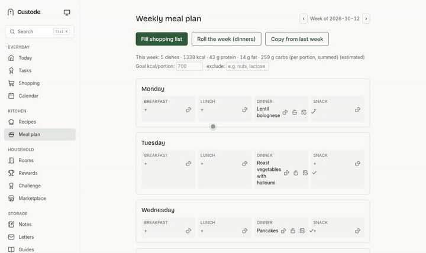
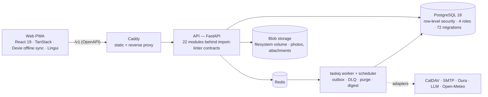

# Custode

**One self-hosted app for the shared life of a household — meals, shopping, chores, calendars and
passwords, for everyone who lives there.**

**[Try the live demo](https://custode-demo.maxlworks.com)** — a shared demo household with the login
filled in, reset every hour. Please don't enter personal data.

<p align="center">
  
</p>

- **Plan the week's dinners** from your recipes and turn them into one shared shopping list that
  works offline in the shop.
- **Share the chores fairly:** recurring tasks per room, points for what gets done, rewards to
  spend them on — booked in a real ledger, not a leaderboard.
- **Keep everyone's calendar together:** personal and household calendars with recurring events,
  CalDAV two-way sync (tested with Radicale) and ICS feeds.
- **Share passwords safely:** a household vault encrypted in the browser — the server only ever
  sees ciphertext.
- **Own the data:** one Docker Compose stack on your hardware, households separated by Postgres
  row-level security, GDPR export and erasure built in, no ads, AGPL-3.0.

[](https://github.com/Juice-de-Orange/Custode/actions/workflows/ci.yml)
[](https://github.com/Juice-de-Orange/Custode/releases/latest)
[](LICENSE)

## Why

Households run on a dozen apps that do not talk to each other, sell the data, or both. Custode
puts the shared life of a household — cooking, shopping, chores, appointments, credentials,
messages, documentation — behind **one** tenant boundary that the database enforces, with a fair
economy for chores (a double-entry points ledger, not a leaderboard), without ads and with GDPR
rights built in from day one (export, erasure, purge jobs, consent for health data).

## How it compares

Custode is younger and smaller than the established self-hosted kitchen and household apps. It
is for a household that wants meals, shopping, chores, calendars and shared passwords in **one**
place with one login. If you need one of those things done exceptionally well, one of these is
probably the better choice today. Checked against each project's README, documentation and latest
release on 2026-10-12:

| | Custode | [Grocy](https://grocy.info) | [Mealie](https://mealie.io) | [Tandoor](https://tandoor.dev) | [KitchenOwl](https://kitchenowl.org) |
|---|---|---|---|---|---|
| Licence | AGPL-3.0 | MIT | AGPL-3.0 | AGPL-3.0 + Commons Clause | AGPL-3.0 |
| Since / latest release | 2026 / v0.1.1 (beta) | 2017 / v4.7.1 | 2020 / v3.28.0 | 2019 / 2.6.15 | 2021 / v0.7.10 (alpha) |
| Recipe import from a URL | yes (schema.org) | add-on only | yes, plus AI and video import | yes, plus AI import | yes |
| Import from other apps | – | – | 9 apps | ~22 apps | – |
| Meal planner | yes, with auto-fill | yes | yes | yes | yes |
| Shopping list offline | yes | no | not documented | partly (queued sync) | partly |
| Pantry, expiry dates, barcodes | – | yes, yes, yes | – | yes, yes, – | – |
| Chores | yes, with points, rewards and a task marketplace | yes, with assignments | – | – | – |
| Expense splitting | – | – | – | – | yes |
| Calendar | household + personal, CalDAV two-way sync, ICS feed | iCal feed | via Home Assistant | meal plan iCal export | – |
| Shared password vault, notes, messages | yes | – | – | – | – |
| Several households per instance | yes (Postgres row-level security) | – | groups and households | spaces and households | households |
| Sign-in options | password, passkeys, TOTP | built-in, LDAP, proxy auth | OIDC, LDAP | OIDC, LDAP, proxy auth | OIDC |
| Native mobile apps | – (installable PWA) | community apps | – | community apps | Android, iOS, F-Droid |
| Home Assistant | – | community | official integration | beta connector | HACS integration |
| UI languages | 2 | 33 | 35+ | ~38 | ~49 |

Where they are better: Grocy has eight years of history and real pantry tooling (barcode
scanners, Open Food Facts, expiry, locations and prices), and it already ships chores and an iCal
feed. Mealie and Tandoor have hundreds of contributors and import recipes from far more sources
and apps. KitchenOwl has official native apps and expense splitting. All four have many more
translations, SSO, a larger community and years of releases; Custode has none of that yet.

## Quick start

```bash
git clone https://github.com/Juice-de-Orange/Custode.git && cd Custode
./setup                # writes .env with generated secrets — nothing to edit
docker compose up -d   # pulls or builds the images, migrates the database, starts everything
```

Open <http://localhost:8080>, sign up, then create your household on the account page that
follows (or join one with an invite code).
Want to look around first? `docker compose run --rm seed-demo` adds an invented, lived-in
household (sign in as `admin@custode.local` / `custode-admin-demo` — a published password, so only
on a trial instance).

From `git clone` to the sign-in page took **1 to 1½ minutes** (66, 72 and 93 s in three runs on
2026-10-12): `up` pulled the v0.1.0 images from GHCR, while the Postgres and Redis images were
already in the Docker cache — on a host without them, add their download (about 180 MB). `up`
builds an image only when it cannot pull it; building everything from source took about 4 minutes
(253 s, no cached images, a ~90 Mbit/s line). Needs Docker with Compose v2.24 or newer (tested
with 2.33 and 5.6) and about 2 GB of disk. The quick start listens on 127.0.0.1 only; to use
Custode from other devices, put it behind HTTPS ([Self-hosting](#self-hosting),
[`docs/operations.md`](docs/operations.md)).

> **Status: beta — current release v0.1.1; one maintainer.** All modules of roadmap phases
> 0–9 are built (CalDAV two-way sync, Oura, GDPR export and erasure included); hardening is in
> progress; the Android app has not started. The maintainer runs one instance for a private
> household; there is no hosted service. Two functional checks ran against a fresh clone — the
> README followed literally, the PWA used in a real browser — covering registration with mail,
> households with a second member and a child, tasks, rooms, shopping, calendar (CalDAV against
> Radicale, ICS), notes, recipes, guides, quick-capture, letters, vault, passkeys and TOTP, tenant
> isolation, GDPR export, the operator console, backup and restore. **Not covered:** real SMTP
> delivery, Oura, quick-capture with an LLM, hardware authenticators (a virtual one was used),
> operation behind a TLS-terminating proxy. Issues and pull requests are welcome.
>
> Built with AI assistance.

**Languages.** The interface ships in English and German: it follows the browser language, falls
back to English, and can be pinned per browser under Profile → Language. This README,
[`docs/ARCHITECTURE.md`](docs/ARCHITECTURE.md), [`docs/operations.md`](docs/operations.md) and
everything an operator needs are English; the concept documents in [`KONFIG/`](KONFIG/) and the
engineering notes in [`docs/`](docs/) (ADRs, module notes, bug log) are German by design.

## Features

- **Recipes and meal planner** — import from URLs (SSRF-guarded), nutrition pipeline, week planner
  with least-recently-cooked and nutrition-aware auto-fill, cooked history, exclusion tags.
- **Shopping list** — generated from the plan, offline-capable, shared.
- **Calendars** — personal and household layers, RRULE recurrence with DST-correct TZIDs, ICS
  import/export with secret feeds, CalDAV pull sync and write-back (Nextcloud, Radicale, …).
- **Household tasks** — rooms, recurring tasks with value decay, a scheduling engine, a
  double-entry points ledger and a marketplace with escrow between members.
- **Vault** — shared credentials encrypted **client-side** (libsodium); the server never sees
  plaintext. One member sets the vault up; the others join it with the household's recovery
  code and their own passphrase.
- **Messaging, guides, notes, comments** — letters with read receipts, a household knowledge base
  with German full-text search, notes with version history, generic object links.
- **Wearables and weather** — Oura OAuth with Art. 9 consent and raw-data retention, Open-Meteo.
- **Quick-capture** — "Zuruf": type a line (or use your keyboard's dictation) and it becomes
  tasks, notes or shopping items via the normal sync path; the structure is parsed
  deterministically, an optional local LLM (Ollama) only enriches free-text fields.
- **Accounts** — passkeys (WebAuthn), TOTP, child accounts with PIN, invite codes, household
  transparency log, operator console on its own subdomain with separate bearer auth.
- **GDPR** — export, household exit, account deletion with nightly purge, household dissolution
  ([`docs/LOESCHKONZEPT.md`](docs/LOESCHKONZEPT.md)).

## Architecture



Modules (`backend/app/modules/*`) import only `kernel/*`, never each other; cross-module
communication goes through domain events (outbox with DLQ) or exported service interfaces —
enforced in CI by 27 import-linter contracts. Every tenant boundary is a Postgres RLS policy with
`FORCE ROW LEVEL SECURITY` and a negative test. The OpenAPI schema is the single source for the
generated TypeScript client and zod schemas (drift gate + `oasdiff` on PRs). Details:
[`docs/ARCHITECTURE.md`](docs/ARCHITECTURE.md) (English), [`KONFIG/ARCHITECTURE.md`](KONFIG/ARCHITECTURE.md)
(full, German), [`docs/adr/`](docs/adr/) (ADR index), [`docs/MODULES/`](docs/MODULES/).

## Self-hosting

The production stack is `docker-compose.prod.yml`: postgres, redis, a one-off `migrate` job, api,
worker, scheduler and `web` (Caddy serving the built PWA and proxying `/v1` to the api). It
expects a TLS-terminating reverse proxy or tunnel in front and publishes no database ports. The
images come from GHCR (`ghcr.io/juice-de-orange/custode-api` and `-web`, multi-arch, published by
the release workflow on every `v*` tag; `CUSTODE_VERSION` in `.env` pins one); where an image
cannot be pulled, Compose builds it from the checkout. The full operator guide —
configuration, proxy, legal pages, backup, restore, update — is
[`docs/operations.md`](docs/operations.md); this section is the short version.

**Bring-up.** On the host, in the cloned repository:

```bash
./setup                      # .env with generated secrets (or: cp .env.prod.example .env and fill it)
# edit .env: delete the COMPOSE_FILE line (that is the localhost quick start), set
# CUSTODE_PUBLIC_BASE_URL and OPS_HOST, and SMTP if you want mail
docker compose -f docker-compose.prod.yml up -d
```

The database roles are created from the `.env` passwords on the **first** start of an empty
`pgdata` volume only. The `migrate` job applies the migrations before api, worker and scheduler
start, on every `up`. An upgrade is `git pull` → `pull` (or `build`) → `up -d`; let the job queue
run empty and take a backup first — the steps are in [`docs/operations.md`](docs/operations.md#update).

**Attaching your proxy.** `web` deliberately publishes no host port. Either put your reverse
proxy or tunnel container on the stack's network (`custode_default`) and point it at
`http://custode-web:80` — a network alias that does not depend on the Compose project name and,
unlike the bare service name `web`, cannot be confused with another stack's `web` when the proxy
joins several networks — or publish the port to the host's loopback with a Compose override
(`services: {web: {ports: ["127.0.0.1:8081:80"]}}`) and proxy to that. Caddy speaks plain HTTP
on :80 for both site blocks. The operator console is a second site on the host name in
`OPS_HOST` (default `ops.localhost`), so the proxy must forward the original `Host` header. The
api's own port (`127.0.0.1:8080`) bypasses Caddy and is meant for health checks.

**First accounts.** Members register in the app; the first one then creates the household on the
account page, the others join it with an invite code. The operator console has no sign-up —
create the first operator on the host:

```bash
docker compose -f docker-compose.prod.yml run --rm api \
    python -m app.scripts.create_operator you@example.org
```

It prints a generated password and the TOTP secret exactly once (TOTP is mandatory for the
console); a re-run for the same address changes nothing.

**Legal pages.** Imprint and privacy policy are yours to provide: put `imprint.md` and
`privacy.md` into the `legal/` folder (see [`legal/README.md`](legal/README.md)); until you do,
the app says that the operator has not provided them.

**Without SMTP.** Leave `CUSTODE_SMTP_HOST` empty (the template ships a placeholder host —
clear it) and the app runs with a null mail adapter: registration and login work, accounts stay
"e-mail not verified" (nothing in the backend is gated on that flag), and **no mail is sent** — no
verification mail, no weekly digest and no password-reset mail. "Forgot password" still answers
204, so without SMTP a forgotten password cannot be reset by the user.

**Backup and restore.** State lives in two places: the `pgdata` volume (everything except
files) and the `storagedata` volume (recipe photos, guide attachments). `redisdata` holds only
the job queue and short-lived state (access tokens, WebAuthn challenges, the household each
signed-in session has active) and needs no backup. One visible consequence of restoring without
it: members who are still signed in land on "No active household" ("Kein Haushalt aktiv") until
they pick the household again on the account page or sign in again — nothing is lost. Keep the `.env` with the
backups — above all `CUSTODE_CRYPTO_KEY`: without the same key, stored CalDAV passwords and
wearable tokens are unreadable and must be entered again.

```bash
# backup
docker compose -f docker-compose.prod.yml exec -T postgres pg_dump -U custode -Fc custode > custode.dump
docker compose -f docker-compose.prod.yml run --rm --no-deps -T api tar czf - -C /data/storage . > storage.tgz

# restore into empty volumes (new host, or after `down -v`), with the saved .env in place
docker compose -f docker-compose.prod.yml up -d --wait postgres redis   # first init creates the roles
docker compose -f docker-compose.prod.yml exec -T postgres pg_restore -U custode -d custode < custode.dump
docker compose -f docker-compose.prod.yml run --rm --no-deps -T api tar xzf - -C /data/storage < storage.tgz
docker compose -f docker-compose.prod.yml run --rm api alembic upgrade head
docker compose -f docker-compose.prod.yml up -d
```

The dump carries no roles — they come from the init script, which is why the restore starts
postgres on an empty volume first.

## Known limitations

- **Quick start.** It listens on `127.0.0.1` only and uses `Secure` cookies, which browsers accept
  on `localhost`; from another device the sign-in only works behind HTTPS.
- **Keys.** There is no rotation path for `CUSTODE_CRYPTO_KEY` ([#7](https://github.com/Juice-de-Orange/Custode/issues/7)). The vault's household key
  is not rotated when a member leaves, and the household recovery code is a shared secret that
  cannot be changed; a member joins the vault with that code (ADR-0067 addendum). Vault data that
  an older version's second "setup" already overwrote is not repaired.
- **Mail.** Without SMTP nobody can reset a forgotten password.
- **Not exercised by the maintainers:** real SMTP delivery, Oura, quick-capture with an LLM,
  hardware authenticators, operation behind a real TLS-terminating proxy.
- **Configuration.** The web app's brand name is a build constant (`web/src/lib/brand.ts`), not
  the `CUSTODE_BRAND_NAME` setting the backend reads. Unknown `CUSTODE_*` variables are ignored
  without a warning, so a typo in `.env` goes unnoticed. The database roles are created only on
  the first start of an empty database volume.
- **Dev stack.** Fixed host ports on all interfaces and a hard-coded Vite proxy target ([#41](https://github.com/Juice-de-Orange/Custode/issues/41)).
- **Scope.** Google CalDAV is not supported ([#9](https://github.com/Juice-de-Orange/Custode/issues/9)); the Android app has not started ([#11](https://github.com/Juice-de-Orange/Custode/issues/11)).

## Development

For working on the code — not for running it. Requirements: [uv](https://docs.astral.sh/uv/),
Node 22, GNU Make, Docker with Compose v2. No system Python is needed: uv installs the interpreter
pinned in `backend/.python-version` (3.13, the same version the container image runs;
`requires-python` is `>=3.12`, but 3.13 is what CI and the image exercise).

```bash
git clone https://github.com/Juice-de-Orange/Custode.git
cd Custode
cp .env.example .env     # dev-safe defaults
make dev                 # api, worker, scheduler, postgres 18, redis, mailpit, radicale
make migrate             # alembic upgrade head
make seed-demo           # an invented, lived-in demo household (dev only)
make install             # uv sync (backend) + npm ci (web)
make web                 # Vite dev server on http://localhost:5173 (proxies /v1 to the API)
```

Log in with the demo account printed by `make seed-demo`. Mail lands in mailpit
(http://localhost:8025). The dev stack is for a developer machine only — it publishes its
database ports and uses fixed passwords. An operator account for the operator console is created
the same way as in production (it prints a password and the TOTP secret once):

```bash
docker compose -f docker-compose.dev.yml run --rm api python -m app.scripts.create_operator you@example.org
```

Checks and code generation:

```bash
make lint          # ruff, mypy --strict, eslint, tsc
make lint-imports  # module boundaries (import-linter)
make test          # pytest (Testcontainers: Postgres 18 + Redis + Radicale) + vitest
make openapi       # export the schema and regenerate the web client
make format
```

The backend suite needs Docker and takes 10–30 minutes on a laptop; CI runs it in about 4
minutes. Gates are listed in [`CLAUDE.md`](CLAUDE.md), which is the binding working instruction
for humans and AI-assisted sessions alike — module boundaries, definition of done, the review
rules this codebase learned the hard way. The bug log ([`docs/BUGLOG.md`](docs/BUGLOG.md)) records
cause, fix, regression test and lesson per bug, and 70+ ADRs ([`docs/adr/`](docs/adr/)) record the
design decisions; German comments and commit messages in the engineering docs come from that
history. See [`CONTRIBUTING.md`](CONTRIBUTING.md).

## Tech stack

Python 3.13 · FastAPI · SQLAlchemy 2 (async) · Alembic · Pydantic v2 · PostgreSQL 18 (RLS) · Redis ·
taskiq · uv · ruff · mypy strict · import-linter · pytest + Testcontainers — React 19 · TypeScript
strict · Vite 6 · TanStack Router + Query · Dexie · Lingui · Tailwind 4 · vitest · axe · Lighthouse
CI — Docker Compose · Caddy · gitleaks · trivy.

## Third-party services

Custode is a self-hostable product; every external service is optional and brought by the operator:
an SMTP account, an Oura OAuth application (for wearables), an Open-Meteo plan (the free API is for
non-commercial use), and an LLM endpoint for quick-capture. Uploaded files are stored on a local
volume ([ADR-0033](docs/adr/0033-blob-storage-photos.md)); no object store is needed.

## Licence

[GNU AGPL-3.0](LICENSE) © 2026 Max Oberrauch. Custode is a network service: if you run a modified
version for others, §13 requires you to offer them the corresponding source — the footer link
"Source code" in the app is where that obligation is met. The bundled fonts (Inter, Bricolage
Grotesque, IBM Plex Mono via `@fontsource`) are under the SIL Open Font License 1.1; icons from
Lucide (ISC).
